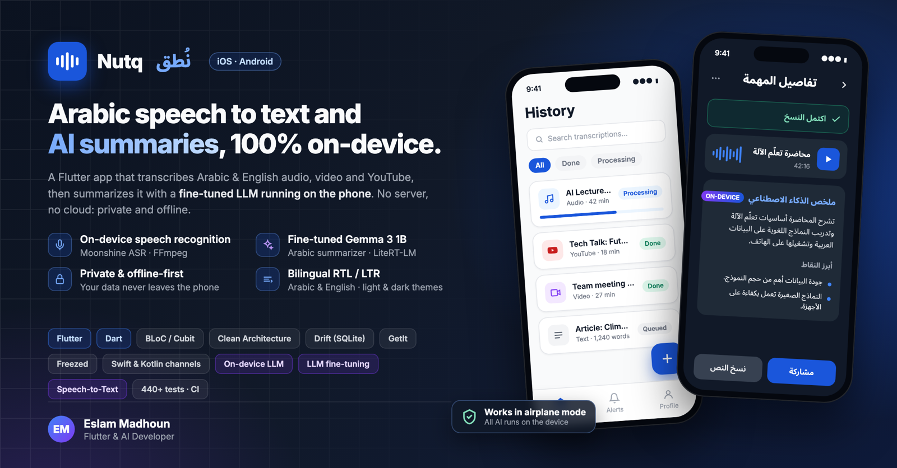
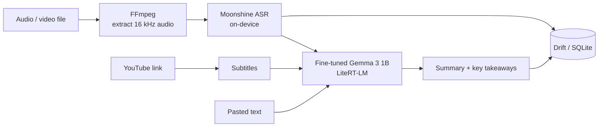

# Nutq · نُطق

**Arabic speech to text and AI summaries, 100% on-device.**



Nutq is a Flutter app for iOS and Android that turns audio, video, YouTube links and pasted
text into a transcript, then writes a summary with key takeaways. Both AI models run on the
phone: there is no server and no cloud API, so recordings never leave the device and the app
works in airplane mode.

## Features

- **Speech to text on the device**: Arabic and English audio and video files are transcribed with
  [Moonshine](https://github.com/moonshine-ai/moonshine), with a live transcript while it runs.
- **AI summaries**: a Gemma 3 1B model, fine-tuned by me for Arabic summarization, writes a
  summary and key takeaways through LiteRT-LM.
- **Several sources**: audio (MP3, WAV, M4A), video (MP4, WebM, MOV), YouTube links (subtitles
  then summary) and pasted text.
- **Background jobs**: a local job queue keeps working when the app is in the background, with
  progress notifications; jobs can be cancelled.
- **Models on demand**: the app installs small (~96 MB on iOS) and downloads each model once,
  with resume and SHA-256 checks.
- **Bilingual**: full Arabic (RTL) and English (LTR) UI, light and dark themes.

## How it works



## AI models

| Model | Role | Size | Source |
|---|---|---|---|
| Gemma 3 1B Arabic summarizer (fine-tuned) | Summary and key takeaways | 553 MB | [Hugging Face](https://huggingface.co/EslamMad3/gemma3-1b-arabic-summarizer-litertlm) |
| Moonshine tiny streaming, Arabic | Speech recognition | 31 MB | download.moonshine.ai |
| Moonshine tiny streaming, English | Speech recognition | 43 MB | download.moonshine.ai |

## Tech stack

| Area | Tools |
|---|---|
| App | Flutter, Dart, Clean Architecture (data / domain / presentation) |
| State and DI | flutter_bloc (Cubit), get_it |
| Data | Drift (SQLite), Freezed, json_serializable |
| On-device AI | LiteRT-LM (via flutter_gemma), Moonshine, FFmpeg |
| Native | Swift and Kotlin platform channels, background processing, notifications |
| Quality | 440+ unit and widget tests, GitHub Actions CI (`flutter analyze --fatal-infos`, `flutter test`) |

## Getting started

Requirements: Flutter 3 (stable), Xcode for iOS 16+, Android SDK for Android 8.0+ (API 26).

```bash
git clone https://github.com/eslammadhoun/nutq.git
cd nutq

# iOS only: fetch the Moonshine framework (~214 MB)
third_party/moonshine/fetch-framework.sh

flutter pub get
cd ios && pod install && cd ..

flutter run --release
```

The models are not in the repository: the app downloads them at the end of onboarding or before
the first job. For architecture, testing and contribution notes, see the
[developer guide](docs/README.md).

## Project structure

```
lib/
  core/        # theme, routing, DI, database, shared widgets
  features/
    jobs/           # job list, new job, job detail, job queue
    transcription/  # FFmpeg + Moonshine speech recognition
    summarization/  # Gemma summarizer and key takeaways
    ai_models/      # model download, checksums, storage
    alerts/ profile/ home/ onBoarding/
```

## Author

**Eslam Madhoun**, Flutter and AI developer.
[GitHub](https://github.com/eslammadhoun) ·
[Hugging Face](https://huggingface.co/EslamMad3)

The fine-tuned summarizer is a Gemma derivative and is subject to the
[Gemma Terms of Use](https://ai.google.dev/gemma/terms); see its Hugging Face page for its license.
